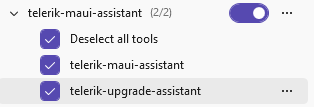

# Telerik UI for .NET MAUI MCP Upgrade Assistant

The Telerik UI for .NET MAUI MCP Upgrade Assistant detects breaking changes in your .NET MAUI project before you upgrade to a newer Telerik UI for .NET MAUI version. The Upgrade Assistant is the `telerik_upgrade_assistant` tool of the [Telerik UI for .NET MAUI MCP server]().

The Upgrade Assistant runs the `telerik migrate analyze` command of the [Telerik CLI]() and returns structured findings to the AI model in your editor. The AI model then explains each finding and can apply the required code fixes.

Use the Upgrade Assistant when you want to:

* Estimate the code changes that an upcoming Telerik UI for .NET MAUI upgrade requires.
* Fix build errors that appear after you update the Telerik UI for .NET MAUI packages.
* Let the AI model apply API renames and signature changes for you.

## Preparing to Use the Upgrade Assistant

Before you run an upgrade analysis, make sure that your environment includes the following:

* [Telerik UI for .NET MAUI MCP server](), installed and configured.
* [Telerik CLI](), installed as a global .NET tool.
* .NET MAUI project (`.csproj`) that references Telerik UI for .NET MAUI.

>tip When the Telerik CLI is missing, the Upgrade Assistant asks for your permission to install it by running the `dotnet tool install --global Telerik.CLI` command. The Upgrade Assistant also checks for Telerik CLI updates and applies them when needed.

## Analyzing a Project with the Upgrade Assistant

To analyze a .NET MAUI project for breaking changes:

1. Open your .NET MAUI solution in Visual Studio, Visual Studio Code.
1. Open the Copilot Chat window.
1. In the tool selection of the chat window, make sure the `telerik-maui-assistant` MCP tool is enabled.

    

1. Enter a prompt that requests an upgrade analysis:

    ```text
    @telerik-maui-assistant Analyze this .NET MAUI project for Telerik-related upgrade issues.
    ```

    To compare two specific Telerik UI for .NET MAUI versions, include both versions in the prompt:

    ```text
    @telerik-maui-assistant Analyze my .NET MAUI project for breaking changes when upgrading from version 14.0.0 to 15.0.0.
    ```

1. Grant permissions when prompted (per session, workspace, or always). The AI model automatically invokes the `telerik_upgrade_assistant` tool, which runs the analysis and returns a structured report of any breaking changes found in your project.
1. Review the report. The AI model groups the findings by file and lists the line numbers, affected API members, and recommended actions.
1. (Optional) Ask the AI model to apply the recommended fixes, and then build the project to verify the changes.

>tip The `telerik_upgrade_assistant` tool uses the Telerik CLI `telerik migrate analyze` command. You can also run this command directly from the terminal. For all available command options, see the [Telerik CLI Migrate Analyzer article]() article.

## Reading the Upgrade Assistant Report

The Upgrade Assistant returns a structured report that includes:

| Field | Description |
|---|---|
| File path | Source file that contains the breaking change. |
| Line number | Line in the source file that contains the breaking change. |
| Member name | Affected API member, such as a property, method, event, or class. |
| Change kind | Type of breaking change, such as removed, renamed, or signature changed. |
| Old signature | Previous API signature, when available. |
| New signature | Replacement API signature, when available. |
| Next steps | Recommended actions that resolve the breaking change. |

## See Also

* [Telerik UI for .NET MAUI MCP Server]()
* [Telerik CLI Overview]()
* [Telerik CLI Migrate Analyzer]()
