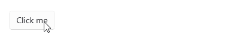

# .NET MAUI Button Command

Use the Telerik UI for .NET MAUI Button `Command` property to run view-model logic without handling the click in code-behind.

The Button exposes the following command-related properties:

- `Command` (`ICommand`)&mdash;Defines the command that runs when the button is activated.
- `CommandParameter` (`object`)&mdash;Defines the parameter passed to that command.

## Using the Command

The following example shows how to bind a command to the Button.

1. Add the `telerik` namespace:

```XAML
xmlns:telerik="http://schemas.telerik.com/2022/xaml/maui"
```

2. Define the Button in XAML:

<snippet id='button-command-xaml' />

3. Add the view model with the command:

<snippet id='button-command' />

The following image shows the Button after the command runs:



> For a runnable example demonstrating Button command binding, see the [SDKBrowser App]() and navigate to **Button** > **Features**.

## See Also

- [Getting Started with the .NET MAUI Button]()
- [Configuring the Button]()
- [Styling the Button]()
- [Creating a Circular Button]()