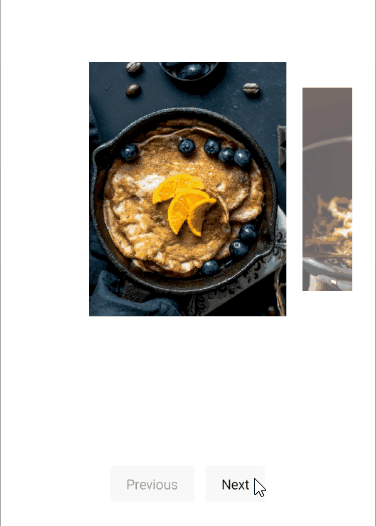

# .NET MAUI Carousel Commands

The Carousel exposes navigation commands that move the highlighted item to the previous or next item. Bind these commands to buttons when you want to provide navigation in addition to swiping, for example, on desktop platforms.

## Navigation Commands and Properties

The Carousel exposes the following read-only commands:

* `NavigatePreviousCommand` (`ICommand`)&mdash;Navigates to the previous item.
* `NavigateNextCommand` (`ICommand`)&mdash;Navigates to the next item.

To allow or prevent navigation in a direction, use the following properties:

* `AllowPrevious` (`bool`)&mdash;Specifies whether the Carousel allows navigation to the previous item. The default value is `true`.
* `AllowNext` (`bool`)&mdash;Specifies whether the Carousel allows navigation to the next item. The default value is `true`.

## Navigate with Previous and Next Buttons

The following example binds two buttons to the navigation commands of the Carousel and uses checkboxes to toggle the `AllowPrevious` and `AllowNext` properties.

1. Define the Carousel and the buttons in XAML:

    <snippet id='carousel-navigation-commands' />

1. Add the `telerik` namespace:

    ```XAML
    xmlns:telerik="http://schemas.telerik.com/2022/xaml/maui"
    ```

1. Define the business object:

    <snippet id='carousel-item-model' />

1. Define the `ViewModel`:

    <snippet id='carousel-viewmodel' />

This is the result:



> tip For a runnable example demonstrating the Carousel commands, see the [SDKBrowser Demo Application]() and go to the **Carousel > Commands** category.

## See Also

- [Highlighted Item]()
- [Carousel Events]()
- [Styling]()
