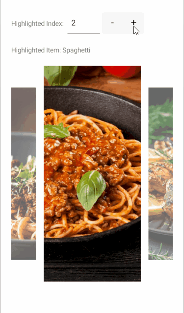

# .NET MAUI Carousel Highlighted Item

The Carousel highlighted item is the item displayed at the center of the viewport. Use it to read which item the user is viewing or to bring a specific item to the center from code.

## Configure the Highlighted Item

To get or set the highlighted item, use the following properties:

* `HighlightedItem` (`object`)&mdash;Specifies the item displayed in the highlighted position.
* `HighlightedIndex` (`int`)&mdash;Specifies the zero-based index of the highlighted item. The value is `-1` when the Carousel has no items. An index outside the item range does not replace the current index.

Both properties update when the user scrolls the Carousel, so you can bind them to your view model to track the current item. To react to the change in code, handle the [`HighlightedItemChanged` event]().

## Display the Highlighted Item and Define the HighlightedIndex

The following example binds a label to the `HighlightedItem` of the Carousel to display the title of the current item and set the `HighlightedIndex` to `2` to bring the third item to the center when the page loads.

1. Define the Carousel in XAML:

    <snippet id='carousel-highlighted-item' />

1. Add the `telerik` namespace:

    ```XAML
    xmlns:telerik="http://schemas.telerik.com/2022/xaml/maui"
    ```

1. Add the business object:

    <snippet id='carousel-item-model' />

1. Define the `ViewModel`:

    <snippet id='carousel-viewmodel' />

When the user scrolls to another item, the label text updates with the title of the new highlighted item.

This is the result:



> tip For a runnable example with the Carousel Highlighted Item scenario, see the [SDKBrowser Demo Application]() and go to the **Carousel > Features** category.

## See Also

- [Carousel Events]()
- [Carousel Commands]()
- [Styling]()
