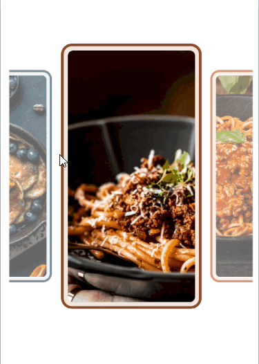

# .NET MAUI Carousel Styling

The Carousel wraps each item in a `RadCarouselItemView` container. `RadCarouselItemView` derives from `RadBorder`, so you can style properties such as `BackgroundColor`, `BorderColor`, `BorderThickness`, `CornerRadius`, and `Padding`.

## Carousel Styling Properties

To style the item containers, use the following properties of the `RadCarousel`:

* `ItemViewStyle` (`Style` with target type `RadCarouselItemView`)&mdash;Specifies the style applied to each item container.
* `ItemViewStyleSelector` (`IStyleSelector`)&mdash;Specifies a selector that chooses a style for each item container. When the selector returns `null`, the Carousel uses the `ItemViewStyle`.

## Visual States of the Item Container

The `RadCarouselItemView` supports visual states in the `CommonStates` visual state group, such as `Normal`, `Highlighted`, `Previous`, `Next`, and their `MouseOver` and `Pressed` variants. For the full list, see the [Carousel Visual States]() article.

## Apply a Custom Item View Style

The following example sets rounded borders and a custom background to all item containers and changes the colors of the highlighted item.

1. Add the style to the page resources:

    <snippet id='carousel-item-view-style' />

1. Apply the style to the Carousel:

    <snippet id='carousel-item-view-style-usage' />

1. Add the `telerik` namespace:

    ```XAML
    xmlns:telerik="http://schemas.telerik.com/2022/xaml/maui"
    ```

1. Add the business object:

    <snippet id='carousel-item-model' />

1. Define the `ViewModel`:

    <snippet id='carousel-viewmodel' />

This is the result:


> tip For a runnable example demonstrating the Carousel styling scenario, see the [SDKBrowser Demo Application]() and go to the **Carousel > Styling** category.

## Apply Styles with a Style Selector

Use a style selector when different items need different styles, for example, to emphasize featured items.

1. Create a class that implements `IStyleSelector`:

    <snippet id='carousel-item-view-style-selector-class' />

1. Define the selector and its styles in the page resources:

    <snippet id='carousel-item-view-style-selector' />

1. Assign the selector to the Carousel:

    <snippet id='carousel-item-view-style-selector-usage' />

1. Add the business object:

    <snippet id='carousel-item-model' />

1. Define the `ViewModel`:

    <snippet id='carousel-viewmodel' />

This is the result:



> tip For a runnable example demonstrating the Carousel style selector scenario, see the [SDKBrowser Demo Application]() and go to the **Carousel > Styling** category.

## See Also

- [Visual States]()
- [Item Effects]()
- [Highlighted Item]()
