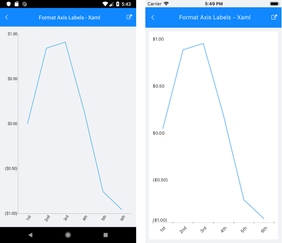

# .NET MAUI Chart DateTime Continuous Axis

Use `DateTimeContinuousAxis` when your chart data contains `DateTime` values and the horizontal or vertical axis must represent a continuous timeline. Instead of treating each value as an isolated category, the axis positions data points according to their time values and builds slots based on `Minimum`, `Maximum`, and `MajorStep`.

`DateTimeContinuousAxis` expects valid `DateTime` values so that the chart can position each data point correctly. If you do not set `Minimum` or `Maximum`, the chart calculates the range from the data. If you do not set `MajorStep`, the chart calculates the interval automatically. The axis can display empty time slots when no data exists for an interval.

`DateTimeContinuousAxis` inherits from `CartesianAxis`. For shared axis members, see the [Chart Axes Overview]().

## When Should You Use DateTimeContinuousAxis

Use `DateTimeContinuousAxis` when you want to:

* Plot data points according to their actual `DateTime` value instead of their position in a category list.
* Show gaps in the timeline when data is missing for certain time intervals.
* Control the timeline range and interval units explicitly.

If each value must appear as a separate category regardless of the time difference between items, use the [Categorical Axis]().

## Features

Use the following properties to configure `DateTimeContinuousAxis`:

* `Minimum` (`DateTime`)&mdash;Defines the start of the timeline. Set it to `DateTime.MinValue` to clear the value and let the axis determine the start from the earliest date.
* `Maximum` (`DateTime`)&mdash;Defines the end of the timeline. Set it to `DateTime.MaxValue` to clear the value and let the axis determine the end from the latest date.
* `PlotMode` (`enum` of type `Telerik.Maui.Controls.Compatibility.Chart.AxisPlotMode`)&mdash;Defines how data points are positioned relative to the time slots. The available values are `BetweenTicks` and `OnTicks`.
* `MajorStep` (`double`)&mdash;Defines the numeric interval between adjacent time slots.
* `MajorStepUnit` (`enum` of type `Telerik.Maui.Controls.Compatibility.Chart.TimeInterval`)&mdash;Defines the `DateTime` component that `MajorStep` uses: `Unset`, `Year`, `Quarter`, `Month`, `Week`, `Day`, `Hour`, `Minute`, `Second`, or `Millisecond`. The default value is `Unset`, which enables automatic unit selection.
* `GapLength` (`double`)&mdash;Defines the distance in logical units `[0,1]` between adjacent time slots. The default value is `0.3`. Set `GapLength` to `0` when clustered bar series must touch.
* `LabelFormat` (`string`)&mdash;Defines the date or time format string for the axis labels, such as `"dd-MM-yy"` or `"HH:mm"`.
* `LabelFormatter` (`Telerik.Maui.Controls.Compatibility.Chart.ILabelFormatter`)&mdash;Defines a custom formatter for the axis labels.

## Example

The following example shows how to format `DateTimeContinuousAxis` labels with a custom formatter.

1. Create the business object class:

   <snippet id='temporal-data-model' />

2. Create a `ViewModel` that exposes time-based data:

   ```C#
   public class ViewModel
   {
       public ObservableCollection<TemporalData> Data { get; set; }

       public ViewModel()
       {
           this.Data = GetDateTimeData(6);
       }

       private static ObservableCollection<TemporalData> GetDateTimeData(int itemsCount)
       {
           var startDate = new DateTime(2015, 03, 01);

           ObservableCollection<TemporalData> items = new ObservableCollection<TemporalData>();
           for (int i = 0; i < itemsCount; i++)
           {
               TemporalData data = new TemporalData();
               data.Date = startDate.AddDays(i);
               data.Value = Math.Sin(i);

               items.Add(data);
           }

           return items;
       }
   }
   ```

3. Create a `DateLabelFormatter` class that inherits from `LabelFormatterBase<DateTime>`:

   ```C#
   public class DateLabelFormatter : LabelFormatterBase<DateTime>
   {
       public override string FormatTypedValue(DateTime value)
       {
           if (value.Day % 100 >= 11 && value.Day % 100 <= 13)
           {
               return value.Day + "th";
           }

           switch (value.Day % 10)
           {
               case 1:
                   return value.Day + "st";
               case 2:
                   return value.Day + "nd";
               case 3:
                   return value.Day + "rd";
               default:
                   return value.Day + "th";
           }
       }
   }
   ```

4. Declare the `RadCartesianChart` in XAML and assign the axis formatter:

   ```xaml
   <telerik:RadCartesianChart>
       <telerik:RadCartesianChart.BindingContext>
           <local:ViewModel />
       </telerik:RadCartesianChart.BindingContext>
       <telerik:RadCartesianChart.HorizontalAxis>
           <telerik:DateTimeContinuousAxis LabelFitMode="Rotate"
                                            MajorStepUnit="Day">
               <telerik:DateTimeContinuousAxis.LabelFormatter>
                   <local:DateLabelFormatter />
               </telerik:DateTimeContinuousAxis.LabelFormatter>
           </telerik:DateTimeContinuousAxis>
       </telerik:RadCartesianChart.HorizontalAxis>
       <telerik:RadCartesianChart.VerticalAxis>
           <telerik:NumericalAxis            MajorStep="0.5"
           Minimum="-1"
           Maximum="1" />
       </telerik:RadCartesianChart.VerticalAxis>
       <telerik:RadCartesianChart.Series>
           <telerik:LineSeries ItemsSource="{Binding Data}"
                               CategoryBinding="Date"
                               ValueBinding="Value" />
       </telerik:RadCartesianChart.Series>
   </telerik:RadCartesianChart>
   ```

In this example, `MajorStepUnit="Day"` sets the time-slot interval to days. The custom formatter displays the day number with an ordinal suffix.

The following image shows the formatted `DateTimeContinuousAxis` labels:



## See Also

* [Categorical Axis]()
* [Numerical Axis]()
* [Chart Axes Overview]()
