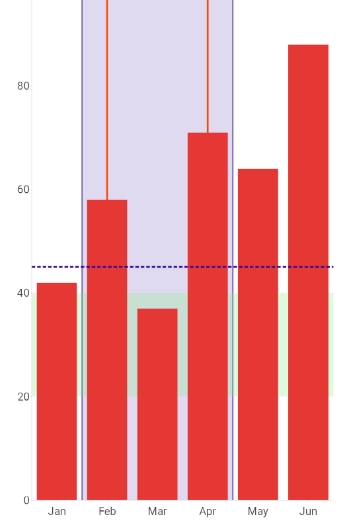

# .NET MAUI Cartesian Chart Annotations

Annotations are visual elements that mark specific values or ranges in the plot area of the Cartesian Chart. Use annotations to highlight a target value, a threshold, an acceptable range, or a period of interest. Annotations don't depend on the series data, so they stay in place when the data changes.

To add annotations, populate the `Annotations` collection of the `RadCartesianChart`. Each annotation must reference an axis that belongs to the same chart, and an annotation instance can't belong to another chart.

## Annotation Types

The Cartesian Chart supports the following annotation types:

| Annotation | Description |
| --- | --- |
| `ChartGridLineAnnotation` | Draws a line across the plot area at an exact axis value or category position. |
| `ChartPlotBandAnnotation` | Draws a band between two exact axis positions. |
| `ChartCategoricalPlotBandAnnotation` | Draws a band over a range of categories and includes the complete slots of the endpoint categories by default. |

## Configure Common Annotation Properties

All annotations share properties that control their visibility and rendering order. Use the following properties to configure any annotation:

* `IsVisible` (`bool`)&mdash;Defines whether the annotation is drawn. The default value is `true`.
* `Opacity` (`double`)&mdash;Defines the opacity of the annotation, from `0` to `1`. The value multiplies the alpha channel of the brushes. The default value is `1`.
* `Layer` (`enum` of type `Telerik.Maui.Controls.Charts.ChartAnnotationLayer`)&mdash;Defines whether the annotation renders below or above the series. The available options are:
  * `BelowSeries`&mdash;Draws the annotation below the grid and the series. This is the default value for plot bands.
  * `AboveSeries`&mdash;Draws the annotation above the series and below the axes. This is the default value for grid lines.
* `ZIndex` (`int`)&mdash;Defines the drawing order within the layer. Annotations with equal values keep their order in the collection.
* `Style` (`Style`)&mdash;Defines a style that merges with the implicit and theme styles of the annotation.

## Configure the Axis and Stroke

Grid line and plot band annotations position themselves against an axis and support a stroke. Use the following properties to set the axis and customize the stroke:

* `Axis` (`Telerik.Maui.Controls.Charts.ChartAxis`)&mdash;Defines the axis against which the annotation is positioned. The axis must belong to the owning chart.
* `Stroke` (`Brush`)&mdash;Defines the stroke brush. The current theme provides the default brush.
* `StrokeThickness` (`double`)&mdash;Defines the stroke thickness in device-independent units. The value must be zero or greater, and `0` hides the stroke. The default value is `1`.
* `StrokeDashArray` (`DoubleCollection`)&mdash;Defines alternating dash and gap lengths in device-independent units. An empty collection draws a solid stroke. A pattern with an odd number of values repeats to form an even-length pattern.

> note The `Stroke` and `Fill` properties of annotations support only `SolidColorBrush` values.

## Mark a Value with a Grid Line

The `ChartGridLineAnnotation` draws a line across the plot area. Use it to mark a threshold, a target, or an average value. Set the following property to position the line:

* `Value` (`object`)&mdash;Defines the position of the line. The value can be a number, a `DateTime`, or a category, depending on the type of the `Axis`.

When the `Axis` is horizontal, the line is vertical. When the `Axis` is vertical, the line is horizontal.

## Highlight a Range with a Plot Band

The `ChartPlotBandAnnotation` fills the area between two positions on an axis. Use it to highlight an acceptable value range or a time period. Use the following properties to configure the band:

* `From` (`object`)&mdash;Defines one endpoint of the band.
* `To` (`object`)&mdash;Defines the other endpoint of the band. When `From` and `To` are equal, the band has zero area.
* `Fill` (`Brush`)&mdash;Defines the fill of the band. The current theme provides the default brush. Set `Fill` to `{x:Null}` to draw only the stroke of the band.

The band normalizes reversed endpoints according to the axis order. The band draws a stroke only at the `From` and `To` boundaries; the edges parallel to the axis have no stroke.

On a `CategoricalAxis`, the `ChartPlotBandAnnotation` boundaries are the category positions, which are the centers of the category slots. To include the complete slots, use the `ChartCategoricalPlotBandAnnotation`.

## Highlight Complete Categories

The `ChartCategoricalPlotBandAnnotation` extends the `ChartPlotBandAnnotation` for categorical axes. Use the following property to define how the band treats the endpoint categories:

* `CategoryBoundaryMode` (`enum` of type `Telerik.Maui.Controls.Charts.ChartCategoryBoundaryMode`)&mdash;Defines whether the band includes the complete category slots or cuts at the category positions. The available options are:
  * (Default) `WholeCategorySlots`&mdash;Includes the complete slots of both endpoint categories. When `From` and `To` are equal, the band highlights one category.
  * `CategoryPositions`&mdash;Uses the exact plotted positions of the endpoint categories.

## Add Annotations to the Chart

The following example shows a `BarSeries` with a categorical plot band, a stroke-only plot band, a value range band, and a dashed threshold line.

1. Define the chart, the axes, the series, and the annotations in Extensible Application Markup Language (XAML). The `Value` of the grid line binds to a `Slider` named `threshold`:

    <snippet id='charts-annotations-xaml' />

1. Add the `charts` namespace:

    ```XAML
    xmlns:charts="clr-namespace:Telerik.Maui.Controls.Charts;assembly=Telerik.Maui.Controls"
    ```

1. Add the data model:

    <snippet id='chart-datamodel-categorical-data' />

1. Add the `ViewModel`:

    <snippet id='chart-categorical-viewmodel' />

The following image shows the result. The band from `Feb` to `Apr` covers three complete categories, the green band marks the range from 20 to 40, and the dashed line marks the threshold value:



> tip For a runnable example with the Cartesian Chart annotations, go to the [SDKBrowser Demo Application]() and navigate to the **Charts > Features** category.

## See Also

- [Grid Lines]()
- [Categorical Axis]()
- [Numerical Axis]()
- [Bar Series]()
