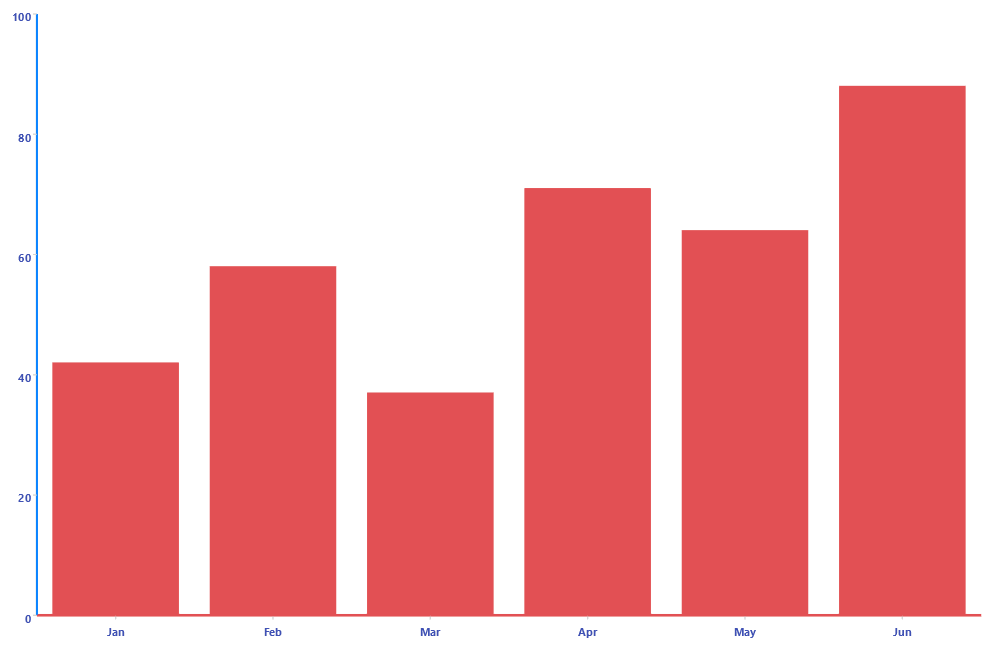

# .NET MAUI Cartesian Chart Categorical Axis

The `CategoricalAxis` arranges the data points in categories. The axis is divided into discrete slots and each data point is visualized in the slot that corresponds to its categorical value. 

Use a `CategoricalAxis` when one of the chart dimensions represents categories rather than numeric values&mdash;for example, when plotting a `BarSeries` against a `NumericalAxis`.

You define the axis through the `Axes` collection of the `RadCartesianChart`.

## Axis Location

Use the `Location` (enum of type `Telerik.Maui.Controls.Charts.ChartAxisLocation`) property to specify the axis location. The available options are `Left`, `Right`, `Top`, or `Bottom`.

Use the `GapLength` (`double`) property to specify the distance between the axis and the chart area.  The value is in the `[0, 1]` range, defaults to `0.3`.

## Line Styling

Use the following properties to customize the appearance of the axis line:

* `LineColor` (`Color`)&mdash;Defines the color of the axis line.
* `LineThickness` (`double`)&mdash;Defines the thickness of the axis line.

## Ticks

Use the following properties to control the ticks of the axis:

* `MajorTickColor` (`Color`)&mdash;Defines the color of the major ticks.
* `MajorTickThickness` (`double`)&mdash;Defines the thickness of the major ticks.
* `MajorTickLength` (`double`)&mdash;Defines the length of the major ticks.

## Plot Mode

The `PlotMode` (enum of type `Telerik.Maui.Controls.Charts.AxisPlotMode`) property defines how the data points are plotted relative to axis ticks. The available options are:

* `BetweenTicks`&mdash;The data points are plotted between two consecutive ticks. This is the default value.
* `OnTicks`&mdash;The data points are plotted directly on the axis tick positions.
* (Default) `OnTicksPadded`&mdash;The data points are plotted directly on the axis tick positions, centered in their slot so the first/last points are inset from the plot area edges.

## Labels Customization

The Categorical Axis exposes the following properties for configuring its position, labels, and appearance:

* `ShowLabels` (`bool`)&mdash;Defines whether the axis labels will be displayed.
* `LabelStyle` (`Style` with target type `ChartLabelAppearance`)&mdash;Defines the style of the axis labels.
* `LabelInterval` (`int`)&mdash;Defines the step at which the axis renders labels.
* `CategoryLabelFormat` (`string`)&mdash;Defines the format of the axis labels. 
* `LabelFitMode` (`Telerik.Maui.Controls.Charts.ChartAxisLabelFitMode`)&mdash;Defines how the axis arranges its labels. This is a flags enumeration, so you can combine `Rotate` and `Stagger` (for example, `LabelFitMode="Rotate, Stagger"`) to distribute rotated labels across multiple tracks. The available options are:
  * (Default) `None`&mdash;The labels are arranged in a single track without rotation.
  * `Stagger`&mdash;The labels are arranged in outward tracks, leaving at least six device-independent units between the labels in the same track. Staggering moves complete labels and does not wrap their text.
  * `Rotate`&mdash;The labels are rotated by the angle defined by the `LabelRotationAngle` property.
* `LabelRotationAngle` (`double`)&mdash;Defines the angle, in degrees, by which the labels are rotated when `LabelFitMode` includes `Rotate`. Positive values rotate the labels clockwise and negative values rotate them counter-clockwise. The value must be finite. The default value is `-45`.
* `LabelDockPoint` (`Point?`)&mdash;Defines the normalized point of the unrotated label box that is attached to the tick position of the label. Both coordinates must be in the `[0, 1]` range, where `(0, 0)` is the top-left corner and `(1, 1)` is the bottom-right corner of the label. The default value is `null`, which centers the label bounds on the tick along the axis and places them beyond the gap between the tick and the label. An explicit point applies even when the labels are not rotated. Explicitly setting the dock point to the center (`0.5, 0.5`) may extend the label toward the plot area.

## Example

The following example shows how to configure a `CategoricalAxis` as the horizontal axis of the chart.

1. Define the `CategoricalAxis` and Chart in XAML:

<snippet id='chart-cartesian-datetime-axis-xaml' />

2. Add the `charts` namespace:
 
```XAML
xmlns:charts="clr-namespace:Telerik.Maui.Controls.Charts;assembly=Telerik.Maui.Controls"
```

3. Add the data model:

<snippet id='chart-datamodel-categorical-data' />

4. Add the `ViewModel`:

<snippet id='chart-categorical-viewmodel' />

This is the result:



> For runnable examples with the Cartesian Chart categorical axes, go to the [SDKBrowser Demo Application]() and navigate to the **Charts > Axes** category.

## See Also

- [Numerical Axis]()
- [Grid Lines]()
