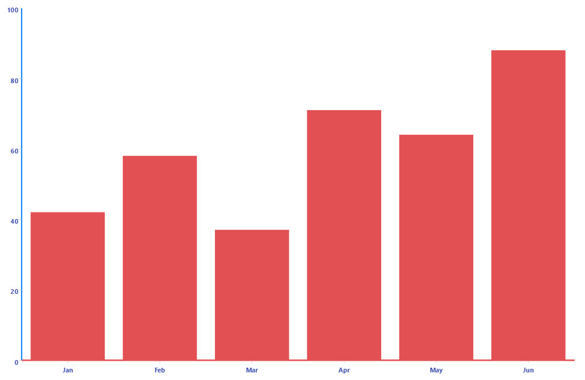

# .NET MAUI Cartesian Chart Numerical Axis

The `NumericalAxis` positions the data points depending on their numerical value. It builds a numerical range&mdash;either user-defined or automatically calculated&mdash;and determines the coordinate of each data point along the axis.

You define the axis through the `Axes` collection of the `RadCartesianChart`.

## Axis Location

Use the `Location` (enum of type `Telerik.Maui.Controls.Charts.ChartAxisLocation`) property to specify the axis location. The available options are `Left`, `Right`, `Top`, or `Bottom`.

## Line Styling

Use the following properties to customize the appearance of the axis line:

* `LineColor` (`Color`)&mdash;Defines the color of the axis line.
* `LineThickness` (`double`)&mdash;Defines the thickness of the axis line.

## Range and Ticks

Use the following properties to control the range and the ticks of the axis:

* `Minimum` (`double`)&mdash;Gets or sets the minimum value of the axis. By default, the axis calculates the minimum from the smallest value of the plotted data points.
* `Maximum` (`double`)&mdash;Gets or sets the maximum value of the axis. By default, the axis calculates the maximum from the largest value of the plotted data points.
* `DesiredTickCount` (`int`)&mdash;Gets or sets the number of ticks that the axis renders.
* `MajorTickColor` (`Color`)&mdash;Defines the color of the major ticks.
* `MajorTickThickness` (`double`)&mdash;Defines the thickness of the major ticks.
* `MajorTickLength` (`double`)&mdash;Defines the length of the major ticks.

## Labels Customization

The Numerical Axis exposes the following properties for configuring the labels and their appearance:

* `ShowLabels` (`bool`)&mdash;Defines whether the axis labels will be displayed.
* `LabelStyle` (`Style`)&mdash;Defines the style, targeting `ChartLabelAppearance`, that applies to the axis labels.
* `LabelInterval` (`int`)&mdash;Defines the step at which the axis renders labels.
* `LabelFitMode` (`Telerik.Maui.Controls.Charts.ChartAxisLabelFitMode`)&mdash;Defines how the axis arranges its labels. This is a flags enumeration, so you can combine `Rotate` and `Stagger` (for example, `LabelFitMode="Rotate, Stagger"`) to distribute rotated labels across multiple tracks. The available options are:
  * (Default) `None`&mdash;The labels are arranged in a single track without rotation.
  * `Stagger`&mdash;The labels are arranged in outward tracks, leaving at least six device-independent units between the labels in the same track. Staggering moves complete labels and does not wrap their text.
  * `Rotate`&mdash;The labels are rotated by the angle defined by the `LabelRotationAngle` property.
* `LabelRotationAngle` (`double`)&mdash;Defines the angle, in degrees, by which the labels are rotated when `LabelFitMode` includes `Rotate`. Positive values rotate the labels clockwise and negative values rotate them counter-clockwise. The value must be finite. The default value is `-45`.
* `LabelDockPoint` (`Point?`)&mdash;Defines the normalized point of the unrotated label box that is attached to the tick position of the label. Both coordinates must be in the `[0, 1]` range, where `(0, 0)` is the top-left corner and `(1, 1)` is the bottom-right corner of the label. The default value is `null`, which centers the label bounds on the tick along the axis and places them beyond the gap between the tick and the label. An explicit point applies even when the labels are not rotated. Explicitly setting the dock point to the center (`0.5, 0.5`) may extend the label toward the plot area.

## Example

The following example shows how to define a `NumericalAxis` with an explicit range and tick count.

1. Define the `NumericalAxis` and the chart definition in XAML:

<snippet id='chart-cartesian-numerical-axis-xaml' />

2. Add the `charts` namespace:
 
```XAML
xmlns:charts="clr-namespace:Telerik.Maui.Controls.Charts;assembly=Telerik.Maui.Controls"
```

3. Add the data model:

<snippet id='chart-datamodel-categorical-data' />

4. Add the `ViewModel`:

<snippet id='chart-categorical-viewmodel' />



> For runnable examples with the Cartesian Chart axes, go to the [SDKBrowser Demo Application]() and navigate to the **Charts > Axes** category.

## See Also

- [Categorical Axis]()
- [Grid Lines]()
