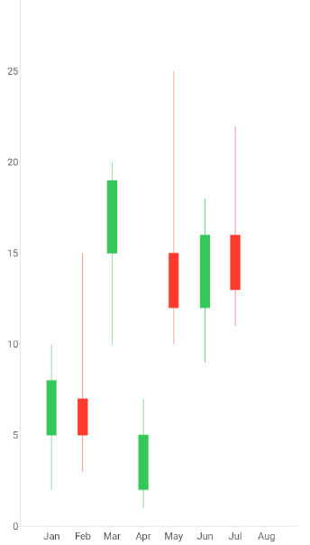

# .NET MAUI Cartesian Chart Candlestick Series

The `CandlestickSeries` visualizes financial data, such as stock prices, as candlesticks. Each candlestick has a filled body that spans the opening and closing prices for a period. 
The Candlestick Series operates with a special data in the form of four parameters defining the stock market&mdash;**open**, **high**, **low**, and **close**. Thin lines, called wicks, extend from the body to the high and low prices.

Use the `CandlestickSeries` when you need to make the price direction of each period easy to identify through the body fill. For a more compact alternative without filled bodies, use the [OHLC Series]().

## Bind the Candlestick Series to Data

The `CandlestickSeries` reads four price values and one category value from each data item. Use the following properties to bind the series:

* `ItemsSource` (`IEnumerable`)&mdash;Defines the collection of data items that the series plots.
* `HorizontalBinding` (`string`)&mdash;Defines the name of the data-item member that provides the category, for example, a date, plotted along the horizontal axis.
* `OpenBinding` (`string`)&mdash;Defines the name of the data-item member that provides the opening price.
* `HighBinding` (`string`)&mdash;Defines the name of the data-item member that provides the highest price.
* `LowBinding` (`string`)&mdash;Defines the name of the data-item member that provides the lowest price.
* `CloseBinding` (`string`)&mdash;Defines the name of the data-item member that provides the closing price.
* `HorizontalAxis` (`Telerik.Maui.Controls.Charts.ChartAxis`)&mdash;Defines the horizontal axis against which the series plots the category values.
* `VerticalAxis` (`Telerik.Maui.Controls.Charts.ChartAxis`)&mdash;Defines the vertical axis against which the series plots the price values.

## Customize the Candlesticks

The `CandlestickSeries` styles each candlestick according to its price direction. A candlestick is bullish when the closing price is higher than the opening price, and bearish otherwise. Use the following properties to customize the candlesticks:

* `BullishFill` (`Brush`)&mdash;Defines the fill of bullish candlestick bodies.
* `BearishFill` (`Brush`)&mdash;Defines the fill of bearish candlestick bodies.
* `BullishStroke` (`Brush`)&mdash;Defines the stroke of the outline and wicks of bullish candlesticks.
* `BearishStroke` (`Brush`)&mdash;Defines the stroke of the outline and wicks of bearish candlesticks.
* `StrokeThickness` (`double`)&mdash;Defines the thickness of the outlines and wicks in device-independent units. The default value is `double.NaN`, which applies the default thickness of the chart.

> note The fill and stroke properties support only `SolidColorBrush` values. When a brush is `null`, the series resolves it from the explicit style, the implicit style, and the theme defaults, in that order.

## Example with Candlestick Series

The following example shows how to define a `CandlestickSeries` with a `DateTimeAxis` and a `NumericalAxis`.

1. Define the `CandlestickSeries` and the chart definition in Extensible Application Markup Language (XAML):

    <snippet id='chart-cartesian-candlestick-series-xaml' />

1. Add the `charts` namespace:

    ```XAML
    xmlns:charts="clr-namespace:Telerik.Maui.Controls.Charts;assembly=Telerik.Maui.Controls"
    ```

1. Add the data model that exposes the `Category`, `Open`, `High`, `Low`, and `Close` properties:

    <snippet id='chart-ohlc-datapoint-csharp' />

1. Add the `ViewModel` that populates the data collection:

    <snippet id='chart-financial-series-viewmodel' />

The following image shows the result, with monthly candlesticks from January to July:



> tip For a runnable example with the Cartesian Chart candlestick series, go to the [SDKBrowser Demo Application]() and navigate to the **Charts > Series** category.

## Known Limitations

The `CandlestickSeries` does not support data point labels.

## See Also

- [OHLC Series]()
- [Bar Series]()
- [Line Series]()
