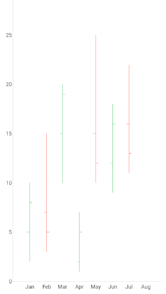

# .NET MAUI Cartesian Chart OHLC Series

The `OhlcSeries` visualizes financial data, such as stock prices, as Open-High-Low-Close (OHLC) bars.
The OHLC Series operates with a special data in the form of four parameters defining the stock market&mdash;**open**, **high**, **low**, and **close**. 
Each data point renders as a vertical line that spans the high and low prices for a period. A left tick marks the opening price and a right tick marks the closing price.

Use the `OhlcSeries` when you need to show price movement over time in a compact form. For a filled-body alternative, use the [Candlestick Series]().

## Bind the OHLC Series to Data

The `OhlcSeries` reads four price values and one category value from each data item. Use the following properties to bind the series:

* `ItemsSource` (`IEnumerable`)&mdash;Defines the collection of data items that the series plots.
* `HorizontalBinding` (`string`)&mdash;Defines the name of the data-item member that provides the category, for example, a date, plotted along the horizontal axis.
* `OpenBinding` (`string`)&mdash;Defines the name of the data-item member that provides the opening price.
* `HighBinding` (`string`)&mdash;Defines the name of the data-item member that provides the highest price.
* `LowBinding` (`string`)&mdash;Defines the name of the data-item member that provides the lowest price.
* `CloseBinding` (`string`)&mdash;Defines the name of the data-item member that provides the closing price.
* `HorizontalAxis` (`Telerik.Maui.Controls.Charts.ChartAxis`)&mdash;Defines the horizontal axis against which the series plots the category values.
* `VerticalAxis` (`Telerik.Maui.Controls.Charts.ChartAxis`)&mdash;Defines the vertical axis against which the series plots the price values.

## Customize the OHLC Bars

The `OhlcSeries` colors each data point according to its price direction. A data point is bullish when the closing price is higher than the opening price, and bearish otherwise. Use the following properties to customize the bars:

* `BullishStroke` (`Brush`)&mdash;Defines the stroke of bullish data points.
* `BearishStroke` (`Brush`)&mdash;Defines the stroke of bearish data points.
* `StrokeThickness` (`double`)&mdash;Defines the thickness of the lines in device-independent units. The default value is `double.NaN`, which applies the default thickness of the chart.

> note The `BullishStroke` and `BearishStroke` properties support only `SolidColorBrush` values. When a brush is `null`, the series resolves it from the explicit style, the implicit style, and the theme defaults, in that order.

## Example with OHLC Series

The following example shows how to define an `OhlcSeries` with a `DateTimeAxis` and a `NumericalAxis`.

1. Define the `OhlcSeries` and the chart definition in Extensible Application Markup Language (XAML):

    <snippet id='chart-cartesian-ohlc-series-xaml' />

1. Add the `charts` namespace:

    ```XAML
    xmlns:charts="clr-namespace:Telerik.Maui.Controls.Charts;assembly=Telerik.Maui.Controls"
    ```

1. Add the data model that exposes the `Category`, `Open`, `High`, `Low`, and `Close` properties:

    <snippet id='chart-ohlc-datapoint-csharp' />

1. Add the `ViewModel` that populates the data collection:

    <snippet id='chart-financial-series-viewmodel' />

The following image shows the result, with monthly OHLC bars from January to July:



> tip For a runnable example with the Cartesian Chart OHLC series, go to the [SDKBrowser Demo Application]() and navigate to the **Charts > Series** category.

## Known Limitations

The `OhlcSeries` does not support data point labels.

## See Also

- [Candlestick Series]()
- [Bar Series]()
- [Line Series]()
