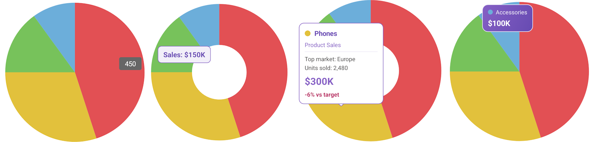

# .NET MAUI PieChart Tooltip

The Telerik UI for .NET MAUI PieChart displays a tooltip with information about a slice when you add a `ChartTooltipBehavior` to the `ChartBehaviors` collection of the chart. The tooltip works with the `PieSeries` and the `DonutSeries`.



## Enable the Tooltip

The following example demonstrates how to add a `ChartTooltipBehavior` to the `ChartBehaviors` collection of the `RadPieChart`. The tooltip opens when you tap a slice and is placed at the data point.

1. Define the `RadPieChart` with a `ChartTooltipBehavior` in XAML:

<snippet id='chart-pie-tooltip-trigger-placement-xaml' />

2. Add the `charts` namespace. The `local` namespace used in the examples points to the namespace in which the data model and the `ViewModel` are defined.

```XAML
xmlns:charts="clr-namespace:Telerik.Maui.Controls.Charts;assembly=Telerik.Maui.Controls"
```

3. Define the data model. The `PieDonutTooltipInfo` record is used to pass additional data to the tooltip through the [`TooltipOpening`](#events) event:

<snippet id='chart-pie-tooltip-datamodel' />

4. Define the `ViewModel`:

<snippet id='chart-pie-tooltip-viewmodel' />

> For a runnable example with the PieChart Tooltip scenarios, go to the [SDKBrowser Demo Application]() and navigate to the **Charts > Tooltip** category.

@[template](/_contentTemplates/controls/charts.md#charts-tooltip-display-position-format)

## Events

The `ChartTooltipBehavior` exposes the `TooltipOpening` event, which is raised before the tooltip opens. The `ChartTooltipOpeningEventArgs` expose the `Series`, `SeriesIndex`, `PointIndex`, `DataItem`, `Value`, `Category`, `FormattedValue`, and `SeriesColor` properties, and the `AdditionalData` property, which you can set to pass custom data to the `TooltipContentTemplate`.

The following example calculates the difference between the actual value and the target value, picks a trend color, and passes both to the tooltip through the `AdditionalData` property. The data is then displayed by the [`TooltipContentTemplate`](#customizing-the-tooltip-content):

<snippet id='chart-pie-tooltip-opening-event' />

## Styling the Tooltip

@[template](/_contentTemplates/controls/charts.md#charts-tooltip-style)

The following example demonstrates how to style the tooltip and format its label.

1. Define the `Style` with target type `ChartTooltip` in the page resources:

<snippet id='chart-pie-tooltip-style' />

2. Set the style to the `TooltipStyle` property of the `ChartTooltipBehavior`. The example also sets the `TooltipLabelFormat` property to format the displayed value:

<snippet id='chart-pie-tooltip-styling-xaml' />

## Customizing the Tooltip Content

Use the `TooltipContentTemplate` property to define custom content. The binding context of the template is a `ChartTooltipContext` object.

The following example displays the series color, the category, the series name, properties from the business object, the formatted value, and the `AdditionalData` set in the `TooltipOpening` event.

1. Define the `TooltipStyle` and the `TooltipContentTemplate` in the page resources:

<snippet id='chart-pie-tooltip-content-template' />

2. Set the style and the template to the `ChartTooltipBehavior`, and subscribe to the `TooltipOpening` event:

<snippet id='chart-pie-tooltip-content-template-xaml' />

3. Add the `TooltipOpening` event handler that sets the `AdditionalData`:

<snippet id='chart-pie-tooltip-opening-event' />

## Customizing the Tooltip Control Template

To fully change the tooltip appearance, set the `ControlTemplate` property of the `ChartTooltip` through the `TooltipStyle`. Use a `ContentPresenter` to display the tooltip content, and bind to the `ChartTooltip` properties, such as the text properties and the `Context`, through a `RelativeSource` binding.

The following example displays the series color and the category above the tooltip content on a gradient background.

1. Define the `ControlTemplate` and the `Style` that applies it in the page resources:

<snippet id='chart-pie-tooltip-control-template' />

2. Set the style to the `TooltipStyle` property of the `ChartTooltipBehavior`:

<snippet id='chart-pie-tooltip-control-template-xaml' />

3. Add the `telerik` namespace, which is used for the `RadBorder` in the `ControlTemplate`:

```XAML
xmlns:telerik="http://schemas.telerik.com/2022/xaml/maui"
```

## See Also

- [Pie Series]()
- [CartesianChart Tooltip]()
