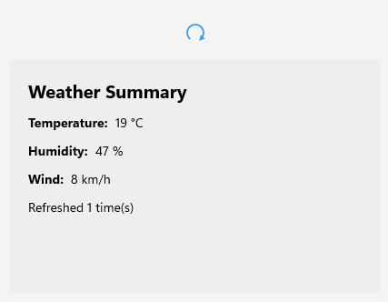

# Getting Started with the .NET MAUI RefreshView

This guide provides the information you need to start using the Telerik UI for [.NET MAUI RefreshView]() by adding the control to your project and reloading data when the user pulls the content.

At the end, you will be able to achieve the following result.



## Prerequisites

Before adding the RefreshView, complete the following steps:

1. [Set up your .NET MAUI application](#step-1-set-up-your-net-maui-application).

1. [Download Telerik UI for .NET MAUI](#step-2-download-telerik-ui-for-net-maui).

1. [Install Telerik UI for .NET MAUI](#step-3-install-telerik-ui-for-net-maui).

## Define the Control

To display the RefreshView on a page and refresh its content, complete the following steps:

1. Add the RefreshView to your page in and set the content you want to refresh:

    <snippet id='refreshview-getting-started-xaml' />
    <snippet id='refreshview-getting-started-csharp' />

2. Add the `telerik` namespace:

    ```XAML
    xmlns:telerik="http://schemas.telerik.com/2022/xaml/maui"
    ```

3. Handle the `Refreshing` event to load the new data. When the data is loaded, set `IsRefreshing` to `false` to end the refresh and hide the indicator:

    <snippet id='refreshview-getting-started-refreshing' />

4. Register the Telerik controls through the `Telerik.Maui.Controls.Compatibility.UseTelerik` extension method called inside the `CreateMauiApp` method of the `MauiProgram.cs` file of your project:

    ```C#
    using Telerik.Maui.Controls.Compatibility;

    public static class MauiProgram
    {
        public static MauiApp CreateMauiApp()
        {
            var builder = MauiApp.CreateBuilder();
            builder
                .UseTelerik()
                .UseMauiApp<App>()
                .ConfigureFonts(fonts =>
                {
                    fonts.AddFont("OpenSans-Regular.ttf", "OpenSansRegular");
                });
            return builder.Build();
        }
    }
    ```

> important The RefreshView doesn't end a refresh automatically. You must set the `IsRefreshing` property to `false` when the data is loaded. Otherwise, the indicator stays visible.

> tip For a runnable example with the RefreshView Getting Started scenario, see the [SDKBrowser Demo Application]() and go to the **RefreshView > Getting Started** category.

## Additional Resources

- [.NET MAUI RefreshView Forum Page](https://www.telerik.com/forums/maui)
- [Telerik .NET MAUI Blogs](https://www.telerik.com/blogs/mobile-net-maui)
- [Telerik .NET MAUI Roadmap](https://www.telerik.com/support/whats-new/maui-ui/roadmap)

## See Also

- [Refresh State]()
- [Indicator Type]()
- [RefreshView Events]()
- [Styling the RefreshView]()
