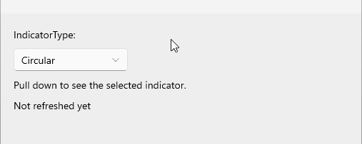
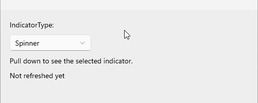
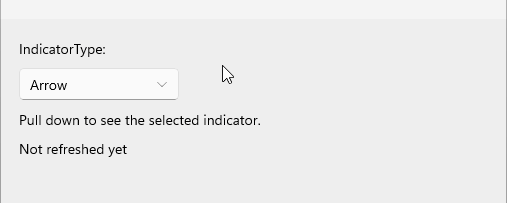

# .NET MAUI RefreshView Indicator Type

The RefreshView indicator type defines the built-in indicator that the control shows while the user pulls the content and while a refresh is in progress. Choose an indicator type to match the look of your app or to keep the same indicator on all platforms.

## Select the Built-In Indicator

To select the built-in indicator, set the `IndicatorType` property (`enum` of type `Telerik.Maui.Controls.RefreshView.RefreshViewIndicatorType`). The property accepts the following values:

* `Circular`&mdash;Displays a circular indicator with a progress arc and a pull arrow. Default on Android.
* `Spinner`&mdash;Displays an indicator with eight rotating bars. Default on iOS and MacCatalyst.
* `Arrow`&mdash;Displays a refresh arrow that rotates while pulling, pulses at the refresh threshold, and spins while refreshing. Default on Windows.

> note When you set the `PullingTemplate` or `RefreshingTemplate` property, the template replaces the built-in indicator for the respective phase. For more information, see [RefreshView Templates]().

>caption Circular indicator



>caption Spinner indicator



>caption Arrow indicator



## Set the Indicator Type

The following example demonstrates how to set the `IndicatorType` property of the RefreshView.

1. Define the RefreshView in XAML:

    <snippet id='refreshview-indicator-type' />

2. Add the `telerik` namespace:

    ```XAML
    xmlns:telerik="http://schemas.telerik.com/2022/xaml/maui"
    ```

3. Handle the `Refreshing` event and end the refresh when the data is loaded:

    <snippet id='refreshview-indicator-type-onrefreshing' />

The following image shows the result:


> tip For a runnable example with the RefreshView Indicator Type scenario, see the [SDKBrowser Demo Application]() and go to the **RefreshView > Configuration** category.

## See Also

- [Styling the RefreshView]()
- [RefreshView Templates]()
- [Transition Mode]()
