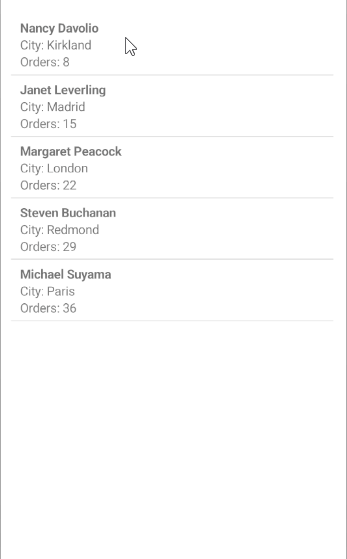

# .NET MAUI RefreshView Integration with CollectionView

You can add pull-to-refresh to the [Telerik UI for .NET MAUI CollectionView]() by wrapping the CollectionView in the RefreshView. Use this approach to let users reload a list of items, for example, customers, messages, or news entries, by pulling the list.



## How the Integration Works

Wrap the `RadCollectionView` in the `RadRefreshView` as its content. When the user pulls the list past the pulling threshold and releases it, the RefreshView starts a refresh and executes its `Command`.

To connect the RefreshView to your view model, bind the following properties:

* `Command` (`ICommand`)&mdash;Executes the view model logic that reloads the items.
* `IsRefreshing` (`bool`)&mdash;Reflects whether a refresh is in progress. The view model sets the property to `false` when the items are loaded to end the refresh.

For more information about the command properties, see [RefreshView Commands]().

## Refresh the CollectionView Items

The following example demonstrates how to use the RefreshView with the CollectionView.

1. Define the RefreshView and the CollectionView in XAML:

    <snippet id='refreshview-integration-collectionview' />

2. Add the `telerik` namespace:

    ```XAML
    xmlns:telerik="http://schemas.telerik.com/2022/xaml/maui"
    ```

3. Define the `ViewModel` with the items, the `IsRefreshing` property, and the `RefreshCommand`:

    <snippet id='refreshview-integration-viewmodel' />

4. Define the `Customer` business object:

    <snippet id='refreshview-integration-customer' />

> tip For a runnable example with the RefreshView Integration with CollectionView scenario, see the [SDKBrowser Demo Application]() and go to the **RefreshView > Integration** category.

## See Also

- [RefreshView Integration with DataGrid]()
- [RefreshView Commands]()
- [Refresh State]()
- [CollectionView Overview]()
