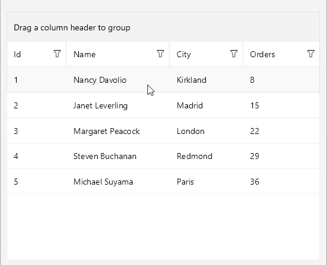

# .NET MAUI RefreshView Integration with DataGrid

You can add pull-to-refresh to the [Telerik UI for .NET MAUI DataGrid]() by wrapping the DataGrid in the Telerik UI for .NET MAUI RefreshView. Use this approach to let users reload tabular data, for example, orders or customer records from a server, by pulling the grid.

@[template](/_contentTemplates/controls/datagrid.md#datagrid-pull-to-refresh)
