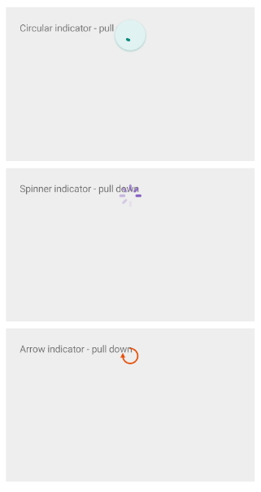

# .NET MAUI RefreshView Styling

The RefreshView lets you style the built-in indicator to match the colors and sizes of your app. To fully replace the indicator, use [RefreshView Templates]() instead.

## Apply an Indicator Style

To style the built-in indicator, use the following properties of the `RadRefreshView`:

* `IndicatorStyle` (`Style`)&mdash;Specifies the style applied to the built-in indicator selected by `IndicatorType`. The `TargetType` of the style must be compatible with the selected indicator. Otherwise, the RefreshView ignores the style. `IndicatorStyle` doesn't change the indicator type.

The following table lists the indicator class that matches each `IndicatorType` value:

| `IndicatorType` | Style `TargetType` |
|-----------------|--------------------|
| `Circular` | `telerik:RadCircularRefreshViewIndicator` |
| `Spinner` | `telerik:RadSpinnerRefreshViewIndicator` |
| `Arrow` | `telerik:RadArrowRefreshViewIndicator` |

## Indicator Styling Properties

All built-in indicators expose the following properties:

* `Color` (`Color`)&mdash;Specifies the color of the indicator.
* `WidthRequest` (`double`)&mdash;Specifies the requested width of the indicator.
* `HeightRequest` (`double`)&mdash;Specifies the requested height of the indicator.

The `RadCircularRefreshViewIndicator` exposes the following additional properties:

* `CircleBackgroundColor` (`Color`)&mdash;Specifies the background color of the circle.
* `CircleRadius` (`double`)&mdash;Specifies the radius of the circle.
* `StrokeThickness` (`double`)&mdash;Specifies the thickness of the progress arc.
* `CircleShadowColor` (`Color`)&mdash;Specifies the color of the circle shadow.
* `CircleShadowOpacity` (`double`)&mdash;Specifies the opacity of the circle shadow.
* `CircleShadowOffset` (`Size`)&mdash;Specifies the offset of the circle shadow.
* `CircleShadowBlurRadius` (`double`)&mdash;Specifies the blur radius of the circle shadow.

## Style the Built-In Indicators

The following example demonstrates how to apply a custom style to each built-in indicator of the `RadRefreshView`.

1. Add the styles to the page resources:

    <snippet id='refreshview-styling-circularindicatorstyle' />
    <snippet id='refreshview-styling-spinnerindicatorstyle' />
    <snippet id='refreshview-styling-arrowindicatorstyle' />

2. Define the RefreshView controls and set the `IndicatorStyle` property:

    <snippet id='refreshview-styling-circular' />
    <snippet id='refreshview-styling-spinner' />
    <snippet id='refreshview-styling-arrow' />

3. Add the `telerik` namespace:

    ```XAML
    xmlns:telerik="http://schemas.telerik.com/2022/xaml/maui"
    ```

4. Handle the `Refreshing` event and end the refresh when the data is loaded:

    <snippet id='refreshview-styling-onrefreshing' />

The following image shows the result:



> tip For a runnable example demonstrating the RefreshView styling, see the [SDKBrowser Demo Application]() and go to the **RefreshView > Styling** category.

## See Also

- [Indicator Type]()
- [RefreshView Templates]()
