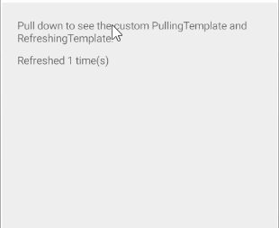

# .NET MAUI RefreshView Templates

The RefreshView templates let you replace the built-in indicator with custom content. Use templates when the `Circular`, `Spinner`, and `Arrow` indicators don't match your design, for example, to show a progress bar and a text message.

## Define Custom Indicator Content

To define custom indicator content, use the following properties:

* `PullingTemplate` (`DataTemplate`)&mdash;Defines the content shown while the user pulls. If the value is `null`, the RefreshView shows the built-in indicator selected by `IndicatorType`.
* `RefreshingTemplate` (`DataTemplate`)&mdash;Defines the content shown while a refresh is in progress. If the value is `null`, the RefreshView shows the built-in indicator selected by `IndicatorType`.

If the root element of a template doesn't have an explicitly set `BindingContext`, the RefreshView sets the binding context to the `RadRefreshView` instance. As a result, you can bind elements in the template to RefreshView properties, for example, to `Progress`, which returns the pull progress from `0.0` to `1.0`.

To set the size of the area that hosts the template, use the `IndicatorLength` property. For more information, see [Thresholds]().

## Show a Progress Bar While Pulling

The following example demonstrates how to show a label and a progress bar while pulling and an activity indicator while refreshing.

1. Define the RefreshView with the `PullingTemplate` and `RefreshingTemplate` in XAML:

    <snippet id='refreshview-templates' />

2. Add the `telerik` namespace:

    ```XAML
    xmlns:telerik="http://schemas.telerik.com/2022/xaml/maui"
    ```

3. Handle the `Refreshing` event and end the refresh when the data is loaded:

    <snippet id='refreshview-templates-onrefreshing' />

The following image shows the result:



> tip For a runnable example with the RefreshView Templates scenario, see the [SDKBrowser Demo Application]() and go to the **RefreshView > Features** category.

## See Also

- [Indicator Type]()
- [Styling the RefreshView]()
- [Thresholds]()
