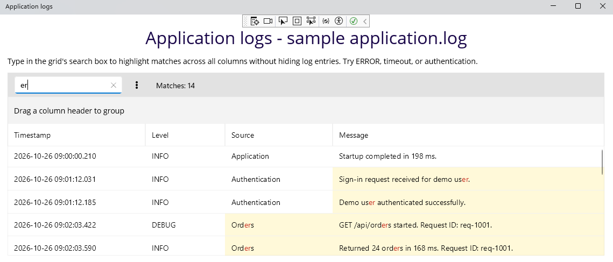

## Environment

| Version | Product | Author | 
| ---- | ---- | ---- | 
| 15.1.0 | Telerik UI for .NET MAUI  DataGrid |[Desislava Yordanova](https://www.telerik.com/blogs/author/desislava-yordanova)| 

## Description

How can I display log text loaded from a database in .NET MAUI, highlight every occurrence of a search term, and let users scroll through the log without hiding surrounding entries?

This article covers logs represented as separate records or lines rather than one continuous text document.

The following image shows the log viewer with search matches highlighted and surrounding entries visible:

## Solution

Use the DataGrid's built-in Search as You Type functionality with filtering disabled.

**1.** Load the log records from your database, bind the collection to the DataGrid's `ItemsSource`, and display the log messages in a `DataGridTextColumn`.

**2.** Reuse the [search-settings example](#search-settings), which applies the following configuration:

* `SearchPanelVisibilityMode="AlwaysVisible"` keeps the search box visible.
* `SearchTrigger="TextChanged"` searches as the user types.
* `TextMatchMode="Contains"` searches for the text anywhere within a cell.
* `ApplyFilter="False"` keeps nonmatching records visible alongside matching records.

**3.** Enter a search term in the search box. With `TextMatchMode="Contains"`, the search highlights every non-overlapping occurrence of the term within the searched text cells, including repeated matches in a single log message.

**4.** Scroll through the log with the DataGrid's built-in scrolling. Disabling filtering preserves the surrounding entries. Do not wrap the DataGrid in another scrolling control.

## Limitations

Search operates on the records loaded into the DataGrid, not directly on the database. If you load records in batches, the search results do not include records that have not been loaded.

If the database returns one continuous text value, first decide whether to present it as separate log records or lines. This configuration describes record-based logs rather than searching a continuous text document.

## See Also

* [DataGrid Scrolling]()